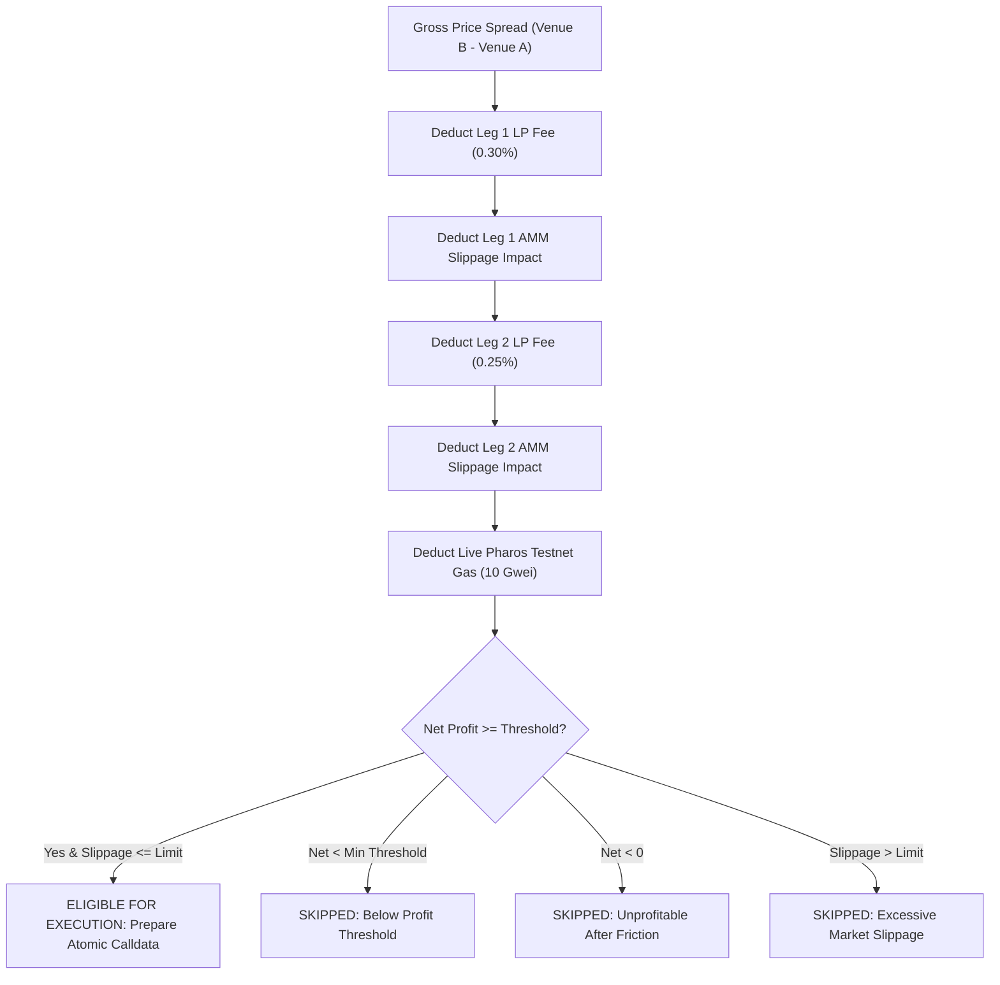

# Pharos Arbitrage Scanner

[](https://github.com/JimmyOgb/pharos-arbitrage-scanner/actions/workflows/ci.yml)
[-00F2FE?style=flat&logo=ethereum)](https://atlantic.pharosscan.xyz)
[](https://github.com/PharosNetwork/pharos-skill-engine)
[](reports/VERIFICATION_REPORT.md)
[](LICENSE)

A high-performance algorithmic DeFi intelligence agent and interactive execution planner built for **Pharos Agent Arena (Season of AI) — Task 7: Arbitrage Scanner**. 

It simultaneously queries token prices across multiple trading venues, computes exact non-linear constant-product slippage ($x \cdot y = k$), nets dual-leg LP fees and real-time network gas costs from Pharos Atlantic Testnet, and evaluates opportunities against configurable risk and profit thresholds before preparing atomic execution bundles.

---

## 1. Official Task Track & Scoring Rubric

- **Task Name**: Arbitrage Scanner (`arbitrage-scanner`)
- **Track**: `SkillEngine`
- **Difficulty Tier**: `Hard`
- **Base Points**: **200 Base Points**
- **Demo Video Bonus**: **+50 Bonus Points** (Total: **250 points**)
- **Official Specification**: [https://pharos-agent-arena.vercel.app/tasks/arbitrage-scanner](https://pharos-agent-arena.vercel.app/tasks/arbitrage-scanner)

| # | Acceptance Criterion | Implementation in `pharos-arbitrage-scanner` | Automated Verification |
|---|---|---|---|
| **01** | **Reads prices from at least 2 sources in the same scan** | Queries Venue A (*PharosSwap V2*), Venue B (*Lighthouse DEX*), and Venue C (*Pyth Benchmark Oracle*) in parallel during each scan cycle. | `test_scan_pair_venues_multi_source` |
| **02** | **Calculates net profit after swap fees, slippage estimate, and gas** | Deducts 0.30% Leg 1 fee, 0.25% Leg 2 fee, non-linear constant-product slippage ($x \cdot y = k$), and live Atlantic Testnet gas at current Gwei. | `test_waterfall_net_profit_deduction`<br>`test_price_impact_increases_with_volume` |
| **03** | **Acts (or prepares the transaction) only above a configurable profit threshold; otherwise logs why it skipped** | Configurable `min_net_profit_usd` and `max_slippage_bps`. Prepares atomic calldata only when eligible; otherwise logs explicit shortfall reasons. | `test_profitable_opportunity_evaluation`<br>`test_below_threshold_status` |
| **04** | **Logs every scan with gross spread, costs, net result and decision** | Immutable structured JSON and tabular trace output detailing gross spread, fees, slippage, gas, net profit, and decision status. | `test_cli_scan_json`<br>`test_multi_pair_batch_evaluation` |
| **05** | **Works safely on testnet or with simulated execution; no requirement to risk real funds** | Dual-mode execution engine: live Atlantic Testnet gas & block reader coupled with a deterministic zero-risk execution sandbox. | `test_execute_simulated_trade`<br>`test_live_atlantic_rpc_connectivity` |

---

## 2. Key Architecture & Features

- **Multi-Venue Price Discovery**: Simultaneously polls pool reserves and spot rates across AMM liquidity pools and benchmark oracles.
- **Mathematically Rigorous AMM Engine**: Exact constant-product output estimation distinguishing marginal spot price from realized execution price.
- **Transparent Waterfall Friction Model**: Deducts gross spread $\to$ Leg 1 LP fee $\to$ Leg 1 slippage $\to$ Leg 2 LP fee $\to$ Leg 2 slippage $\to$ real network gas $\to$ net profit.
- **Live Atlantic Testnet Integration**: Polling live gas price (`eth_gasPrice` ~ 10.0 Gwei) and block progression from `https://atlantic.dplabs-internal.com`.
- **Atomic Multi-Call Calldata Generator**: Formats canonical `swapExactTokensForTokens` multi-leg transaction bundles with deadline and slippage protection.
- **Premium Web Dashboard**: Responsive dark Web3 UI with interactive trade volume sliders, live gas display, waterfall flow diagrams, and a simulated execution trigger.
- **$0-First Architecture**: Standard Python library engine (zero runtime pip dependencies) paired with a zero-build static frontend ready for Vercel.

---

## 3. Mathematical AMM Slippage Formulation ($x \cdot y = k$)

For a constant-product liquidity pool with reserves $(R_{in}, R_{out})$ and swap fee ratio $f = 0.003$:

### Effective Input
$$\Delta x_{eff} = \Delta x \cdot (1 - f)$$

### Realized Output
$$\Delta y = \frac{R_{out} \cdot \Delta x_{eff}}{R_{in} + \Delta x_{eff}}$$

### Pre-Trade Spot Rate vs Effective Execution Rate
$$P_{spot} = \frac{R_{in}}{R_{out}}$$
$$P_{exec} = \frac{\Delta x}{\Delta y}$$

### Price Impact (Curve Slippage)
$$\text{Price Impact Ratio} = \frac{|P_{exec} - P_{spot}|}{P_{spot}}$$
$$\text{Price Impact (bps)} = \text{Price Impact Ratio} \times 10,000$$

---

## 4. Transparent Profit Waterfall Deduction Model



---

## 5. Network & Contract Configuration

### Pharos Atlantic Testnet (Primary)
- **Chain ID**: `688689` (`0xa8231`)
- **Direct JSON-RPC**: `https://atlantic.dplabs-internal.com`
- **Hosted Chain MCP**: `https://mcp.pharos.xyz/mcp`
- **Block Explorer**: `https://atlantic.pharosscan.xyz`
- **Native Gas Currency**: `PHRS` (18 decimals)
- **Average Gas Price**: `10.0` Gwei
- **Block Time**: ~1.0 second

### Verified On-Chain Tokens
- **USDC**: `0xcfC8330f4BCAB529c625D12781b1C19466A9Fc8B` (Bytecode verified)
- **Alternate USDC**: `0xE0BE08c77f415F577A1B3A9aD7a1Df1479564ec8` (Live balance verified)
- **WPHRS**: `0x838800b758277CC111B2d48Ab01e5E164f8E9471` (Bytecode verified)
- **MultiCall3**: `0xcA11bde05977b3631167028862bE2a173976CA11` (Bytecode verified)

---

## 6. Quickstart & Installation ($0 Budget)

### Prerequisites
- Python `>= 3.9`
- Modern web browser (Chrome, Firefox, Brave, Safari)
- Internet connection for Atlantic Testnet live RPC polling

### Setup
```bash
# Clone the repository
git clone https://github.com/JimmyOgb/pharos-arbitrage-scanner.git
cd pharos-arbitrage-scanner

# Optional: Install pytest for testing
pip install pytest
```

---

## 7. Command Line Interface (CLI) Usage

### 1. Scan Configured Trading Pairs
```bash
# Scan with default parameters ($5,000 volume, $5.00 min profit, 150 bps max slippage)
python scripts/scanner.py scan

# Scan specific pair with custom volume and min profit
python scripts/scanner.py scan --pair PHRS/USDC --volume 2500 --min-profit 5.0

# Output machine-readable JSON for agent consumption
python scripts/scanner.py scan --json
```

### 2. Run Canonical Benchmark Scenarios
```bash
# Runs 4 side-by-side market conditions with simulated execution
python scripts/scanner.py demo
```

### 3. Query Live Atlantic Testnet Gas
```bash
# Direct RPC query to Pharos Atlantic node
python scripts/scanner.py live-gas
```

---

## 8. Interactive Web Dashboard & Local Server

Launch the local server to explore the visual dashboard:

```bash
python scripts/server.py
```
Open **[http://localhost:8088](http://localhost:8088)** in your browser.

### Key Visual Features:
- **Real-Time Atlantic RPC Status**: Live gas tracker (10.0 Gwei) and sub-second block counter.
- **Interactive Waterfall Flow**: Visual bar diagram breaking down fees, slippage, and gas.
- **Scenario Quick Presets**: One-click switching between Wide Spread, Slippage-Eroded, Gas-Eroded, and Inverted Spread.
- **Calldata Inspector**: Inspect raw atomic trade calldata payload.
- **Execution Simulation Sandbox**: Click "Simulate Atomic Arbitrage" to generate deterministic testnet receipts (`0xsim_arb_...`).

---

## 9. Canonical Market Scenarios

| Scenario | Market Condition | Trade Size | Gross Spread | Total Friction | Net Profit | Decision |
|---|---|---|---|---|---|---|
| **Profitable Arb** | Wide divergence between PharosSwap ($2.50) & Lighthouse ($2.56) | $5,000 | +$120.00 (+2.40%) | -$70.45 | **+$49.55** | `ELIGIBLE_FOR_EXECUTION` |
| **Slippage-Eroded** | 0.80% spread on shallow pool depth | $5,000 | +$40.00 (+0.80%) | -$914.91 | **-$874.91** | `SKIPPED_EXCESSIVE_SLIPPAGE` |
| **Gas-Eroded** | Micro-spread (0.15%) on stablecoin pair | $5,000 | +$7.50 (+0.15%) | -$27.51 | **-$20.01** | `SKIPPED_UNPROFITABLE_AFTER_COSTS` |
| **Inverted Market** | Efficient / negative spread | $5,000 | $0.00 (0.00%) | -$0.0074 | **-$0.0074** | `SKIPPED_NEGATIVE_SPREAD` |

---

## 10. Atomic Calldata Payload Specification

When an opportunity satisfies all threshold conditions, the engine constructs an atomic dual-leg bundle:

```json
{
  "type": "ATOMIC_ARBITRAGE_BUNDLE",
  "network": "Pharos Atlantic Testnet",
  "chain_id": 688689,
  "pair": "PHRS/USDC",
  "trade_volume_usd": 2500.0,
  "expected_net_profit_usd": 23.79,
  "deadline_epoch": 1792345000,
  "legs": [
    {
      "step": 1,
      "venue": "PharosSwap V2",
      "action": "SWAP_QUOTE_TO_BASE",
      "amount_in": 2500.0,
      "effective_rate": 2.5126,
      "slippage_bps": 44.8,
      "encoded_calldata": "0x38ed1739..."
    },
    {
      "step": 2,
      "venue": "Lighthouse DEX",
      "action": "SWAP_BASE_TO_QUOTE",
      "expected_net_out": 2523.79,
      "effective_rate": 2.5478,
      "slippage_bps": 44.2,
      "encoded_calldata": "0x38ed1739..."
    }
  ]
}
```

---

## 11. Automated Testing Suite (38 Tests Passing)

The project includes **38 automated unit, integration, and live network tests**:

```bash
# Run the complete test suite
python -m pytest tests/ -v
```

### Test Modules:
- `tests/test_amm.py` (12 tests): Constant product math, reserve bounds, zero liquidity, non-linear price impact, micro-volume precision.
- `tests/test_costs.py` (5 tests): LP fees, gas conversions, waterfall deduction, fallback behavior.
- `tests/test_venues.py` (5 tests): Multi-venue discovery, pair configs, reserve overrides, freshness tracking.
- `tests/test_evaluator.py` (8 tests): Threshold logic, excessive slippage guardrails, gas spike erosion, multi-pair batch evaluations.
- `tests/test_payload.py` (3 tests): Calldata generation, fail-closed barriers, simulated receipt confirmation.
- `tests/test_cli.py` (3 tests): CLI arguments, JSON outputs, 4-case benchmark suite execution.
- `tests/test_live_network.py` (2 tests): Live Atlantic Testnet RPC connectivity, Chain ID 688689 validation.

---

## 12. Security Boundaries & Zero-Risk Guarantees

1. **Zero Private Key Exposure**: The engine never requests, stores, or handles private keys, seed phrases, or wallet secrets.
2. **Fail-Closed Threshold Gating**: If an opportunity does not exceed `min_net_profit_usd` or exceeds `max_slippage_bps`, the engine halts trade construction and logs the shortfall.
3. **No Fabricated Receipts**: Simulated receipts are explicitly prefixed with `0xsim_arb_...` and labeled `[SIMULATED]` in logs and UI.
4. **Network Guardrails**: Validates Atlantic Testnet (`Chain ID: 688689`). Disallows Pacific Mainnet execution.

---

## 13. Vercel Deployment Instructions

The web visualizer in `web/` is pre-configured for instant zero-build deployment on Vercel:

1. Import the repository `https://github.com/JimmyOgb/pharos-arbitrage-scanner` on Vercel.
2. The included [`vercel.json`](vercel.json) automatically directs traffic to `web/`:
   ```json
   {
     "version": 2,
     "framework": null,
     "outputDirectory": "web",
     "cleanUrls": true
   }
   ```
3. Zero build commands, zero npm dependencies, zero environment variables required.

---

## 14. SkillEngine Standard Files

Adheres to the official **Pharos SkillEngine Specification (v0.1.0)**:
- [`SKILL.md`](SKILL.md): Main skill entrypoint and capability index.
- [`assets/networks.json`](assets/networks.json): Testnet and Mainnet RPC parameters.
- [`assets/tokens.json`](assets/tokens.json): Verified token registry.
- [`assets/venues.json`](assets/venues.json): Trading pool parameters and scenarios.
- [`references/scanner.md`](references/scanner.md): Command interfaces, JSON schemas, and error codes.
- [`reports/IMPLEMENTATION_PLAN.md`](reports/IMPLEMENTATION_PLAN.md): Pre-implementation discovery and architecture audit.
- [`reports/VERIFICATION_REPORT.md`](reports/VERIFICATION_REPORT.md): Comprehensive test results and verification evidence.

---

## 15. License

MIT License. Copyright (c) 2026 JimmyOgb.
