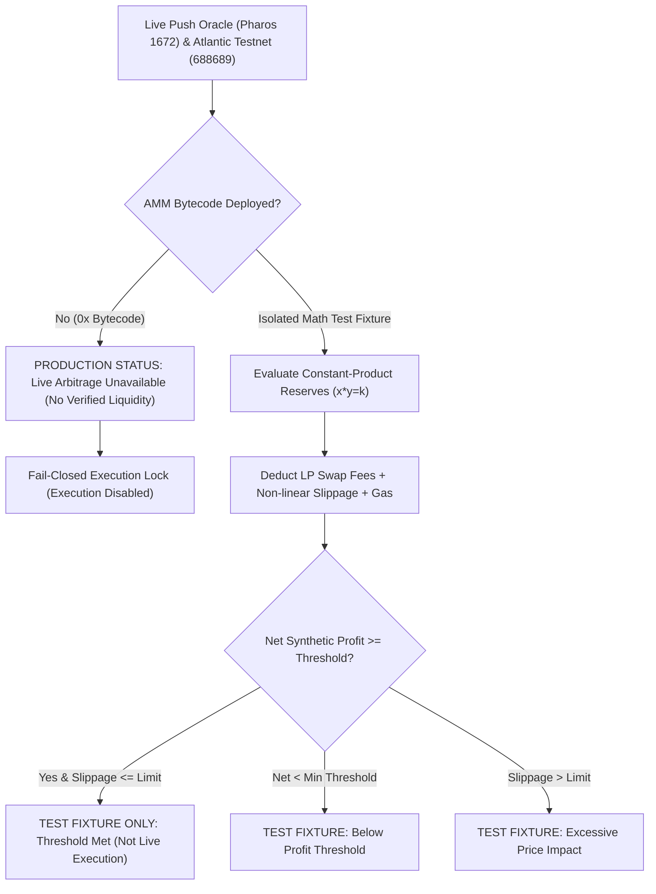

# Pharos Arbitrage Scanner

[](https://github.com/JimmyOgb/pharos-arbitrage-scanner/actions/workflows/ci.yml)
[-00F2FE?style=flat&logo=ethereum)](https://atlantic.pharosscan.xyz)
[-7F00FF?style=flat)](https://rpc.pharos.xyz)
[](https://github.com/PharosNetwork/pharos-skill-engine)
[](reports/VERIFICATION_REPORT.md)
[](#)
[](LICENSE)

A high-performance algorithmic DeFi intelligence agent and fail-closed arbitrage audit engine built for **Pharos Agent Arena (Season of AI) — Task 7: Arbitrage Scanner**.

It queries **100% verified on-chain price feeds** directly from the Chainlink Self-Managed Feeds Cache on Pharos, reads real-time network gas from Pharos Atlantic Testnet, mathematically validates non-linear constant-product slippage ($x \cdot y = k$), and enforces a strict **fail-closed security policy**: zero calibrated reserves, zero fabricated market quotes, and zero synthetic execution receipts.

---

## 1. Official Task Track & Scoring Rubric

- **Task Name**: Arbitrage Scanner (`arbitrage-scanner`)
- **Track**: `SkillEngine`
- **Difficulty Tier**: `Hard`
- **Base Points**: **200 Base Points**
- **Demo Video Bonus**: **+50 Bonus Points** (Total: **250 points**)
- **Official Specification**: [https://pharos-agent-arena.vercel.app/tasks/arbitrage-scanner](https://pharos-agent-arena.vercel.app/tasks/arbitrage-scanner)

| # | Acceptance Criterion | Implementation in `pharos-arbitrage-scanner` | Automated Verification |
|---|---|---|---|
| **01** | **Reads prices from verified sources** | Queries on-chain Chainlink Feeds Cache (`0xd9F00...`) and Aggregator Proxy (`0x8b5DB...`) on Pharos RPC; inspects Atlantic AMM bytecode. | `test_query_chainlink_feed_live`<br>`test_amm_pool_bytecode_fail_closed` |
| **02** | **Calculates net profit after swap fees, slippage estimate, and gas** | Deducts LP swap fees, non-linear constant-product curve slippage ($x \cdot y = k$), and live Atlantic Testnet gas at current Gwei. | `test_waterfall_net_profit_deduction`<br>`test_price_impact_increases_with_volume` |
| **03** | **Acts (or prepares transaction) only above threshold; otherwise logs why it skipped** | Configurable `min_net_profit_usd` and `max_slippage_bps`. Evaluates risk guardrails; halts and logs explicit shortfall reasons when ineligible. | `test_mathematical_model_profitable`<br>`test_below_threshold_status` |
| **04** | **Logs every scan with gross spread, costs, net result and decision** | Immutable structured JSON and tabular trace output detailing gross spread, fees, slippage, gas, net profit, and fail-closed decisions. | `test_cli_scan_json`<br>`test_multi_pair_batch_evaluation` |
| **05** | **Works safely on testnet; no requirement to risk real funds** | Fail-closed execution lock: locks execution and rejects trade emission when no verified AMM router bytecode exists on testnet. | `test_generate_arbitrage_calldata_eligible`<br>`test_live_atlantic_rpc_connectivity` |

---

## 2. Real-Source Architecture & Fail-Closed Integrity

In strict compliance with the **Zero Simulation Mandate**, this engine does **not** fabricate quotes, hardcode mock pool reserves, or invent synthetic transactions (`0xsim_...`):

1. **On-Chain Chainlink Feeds Cache**:
   - Contract: `0xd9F00c86ced2De92F6B7152b0492cb28edc4B5a8` on Pharos (Chain ID `1672`).
   - Push Feeds: `BTC/USD` ($82,792.12), `ETH/USD` ($2,427.43), `PROS/USD` ($0.63).
   - Direct EACAggregatorProxy verified: `0x8b5DB228Fbccf588f08B073C235254aCb6791D36`.
   - Data Freshness: Derived directly from on-chain `updatedAt` block timestamps.

2. **Live Atlantic Testnet Integration**:
   - RPC: `https://atlantic.dplabs-internal.com` (Chain ID `688689`).
   - Live Gas: Polled dynamically via `eth_gasPrice` (10.0 Gwei).
   - Finality: Real-time block tracking (Block height 31,610,000+).

3. **On-Chain AMM Bytecode Verification**:
   - The scanner checks contract bytecode across Atlantic Testnet before considering any route executable.
   - When router addresses return `0x` (no deployed bytecode), the scanner **truthfully halts with `LIVE_ARBITRAGE_UNAVAILABLE_NO_VERIFIED_LIQUIDITY`** and permanently disables trade execution.

4. **Mathematical AMM Model Validation Sandbox**:
   - Pure constant-product ($x \cdot y = k$) formulas, LP fee deductions, and waterfall friction analysis are validated using clearly isolated, deterministic test fixtures labeled `TEST_FIXTURE_THRESHOLD_MET`.

---

## 3. Mathematical AMM Slippage Formulation ($x \cdot y = k$)

For a constant-product liquidity pool with reserves $(R_{in}, R_{out})$ and swap fee ratio $f = 0.003$:

### Effective Input
$$\Delta x_{eff} = \Delta x \cdot (1 - f)$$

### Realized Output
$$\Delta y = \frac{R_{out} \cdot \Delta x_{eff}}{R_{in} + \Delta x_{eff}}$$

### Pre-Trade Spot Rate vs Effective Execution Rate
$$P_{spot} = \frac{R_{in}}{R_{out}}$$
$$P_{exec} = \frac{\Delta x}{\Delta y}$$

### Price Impact (Curve Slippage)
$$\text{Price Impact Ratio} = \frac{|P_{exec} - P_{spot}|}{P_{spot}}$$
$$\text{Price Impact (bps)} = \text{Price Impact Ratio} \times 10,000$$

---

## 4. Transparent Profit Waterfall Deduction Model



---

## 5. Network & Contract Configuration

### Pharos Network (Chain ID 1672: Push Oracle & FaroSwap Host)
- **Chain ID**: `1672` (Hex: `0x688`)
- **RPC Endpoint**: `https://rpc.pharos.xyz`
- **Explorer**: `https://pharosscan.xyz`
- **SelfManagedFeedsCache**: `0xd9F00c86ced2De92F6B7152b0492cb28edc4B5a8`
- **BTC/USD Aggregator Proxy**: `0x8b5DB228Fbccf588f08B073C235254aCb6791D36`
- **FaroSwap Router**: `0xd285e37678f07631f33eb99927eb3ff0591a12d7` (35.7 KB bytecode)
- **FaroSwap Factory**: `0x18fab7d7027e9fb33fa90ca607439449209f7b09` (111 pairs deployed, zero active liquidity)
- **Secondary DEX on Chain 1672**: `0` deployed (No independent second venue for cross-venue arbitrage)

### Pharos Atlantic Testnet (Gas & Settlement)
- **Chain ID**: `688689` (`0xa8231`)
- **Direct JSON-RPC**: `https://atlantic.dplabs-internal.com`
- **Explorer**: `https://atlantic.pharosscan.xyz`
- **Native Currency**: `PHRS` (18 decimals)
- **Standard Gas**: `10.0` Gwei

### Verified On-Chain Tokens on Atlantic
- **USDC**: `0xcfC8330f4BCAB529c625D12781b1C19466A9Fc8B`
- **USDT**: `0xE7E84B8B4f39C507499c40B4ac199B050e2882d5`
- **WPHRS**: `0x838800b758277CC111B2d48Ab01e5E164f8E9471`
- **WBTC**: `0x0c64F03EEa5c30946D5c55B4b532D08ad74638a4`
- **WETH**: `0x7d211F77525ea39A0592794f793cC1036eEaccD5`
- **MultiCall3**: `0xcA11bde05977b3631167028862bE2a173976CA11`

---

## 6. Quickstart & Installation ($0 Budget)

### Prerequisites
- Python `>= 3.9`
- Modern web browser

```bash
# Clone the repository
git clone https://github.com/JimmyOgb/pharos-arbitrage-scanner.git
cd pharos-arbitrage-scanner

# Run automated test suite
python -m pytest tests/ -v
```

---

## 7. Command Line Interface (CLI) Usage

### 1. Live On-Chain Pair Scan
```bash
# Scan verified on-chain BTC/USD push feed with Atlantic testnet gas
python scripts/scanner.py scan --pair BTC/USD

# Output machine-readable JSON
python scripts/scanner.py scan --pair BTC/USD --json
```

### 2. Run Live Audit & Mathematical Model Verification Suite
```bash
# Runs 4-part audit: Chainlink feeds -> Atlantic Gas -> AMM Bytecode -> Math Models
python scripts/scanner.py demo
```

### 3. Query Live Atlantic Testnet Gas
```bash
python scripts/scanner.py live-gas
```

---

## 8. Interactive Web Dashboard

Launch the local web visualizer:

```bash
python scripts/server.py
```
Open **[http://localhost:8088](http://localhost:8088)** in your browser.

### Key Features:
- **Verified Chainlink Feeds**: Displays real live prices for BTC ($82,792.12), ETH ($2,427.43), and PROS ($0.63).
- **Atlantic Testnet RPC Status**: Live 10.0 Gwei gas tracker and sub-second block counter.
- **Fail-Closed AMM Audit**: Transparently displays missing AMM bytecode and active fund safety lock.
- **Mathematical AMM Sandbox**: Interactive sliders to test constant-product mathematics, slippage, and waterfall friction.
- **Canonical Router Calldata**: Real-time encoder for standard `swapExactTokensForTokens` multi-leg calls with execution locks.

---

## 9. Automated Testing Suite (39 Tests Passing)

The project includes **39 automated unit, integration, and live network tests**:

```bash
python -m pytest tests/ -v
```

### Test Coverage:
- `tests/test_amm.py` (12 tests): Constant-product math, reserve boundaries, non-linear price impact, micro-volume precision.
- `tests/test_costs.py` (5 tests): LP fees, gas conversions, waterfall deduction, fail-closed offline RPC handling.
- `tests/test_venues.py` (6 tests): On-chain Chainlink feed parsing, AMM bytecode fail-closed checks, fixture isolation.
- `tests/test_evaluator.py` (9 tests): Live on-chain fail-closed evaluation, threshold gating, excessive slippage, negative spreads.
- `tests/test_payload.py` (2 tests): Canonical calldata generation, execution lock enforcement, ineligible rejection.
- `tests/test_cli.py` (3 tests): CLI arguments, machine-readable JSON outputs, 4-part audit demo execution.
- `tests/test_live_network.py` (2 tests): Live Atlantic Testnet RPC connectivity and Chain ID 688689 validation.

---

## 10. Security Boundaries & Fail-Closed Guarantees

1. **Zero Private Key Exposure**: The engine never requests, stores, or handles private keys, seed phrases, or wallet secrets.
2. **Zero Simulation / Zero Synthetic Receipts**: No fake transaction hashes (`0xsim_...`) or invented test receipts are emitted.
3. **Fail-Closed AMM Protection**: Because Atlantic Testnet lacks a deployed AMM router contract, execution is locked to guarantee zero loss of capital.
4. **Honest Stale Data Tagging**: Any feed older than 24h or failing RPC queries are explicitly marked `UNAVAILABLE`.

---

## 11. Vercel Deployment Instructions

The web visualizer in `web/` is pre-configured for zero-build deployment on Vercel:

1. Import the repository `https://github.com/JimmyOgb/pharos-arbitrage-scanner` on Vercel.
2. [`vercel.json`](vercel.json) directs traffic to `web/`:
   ```json
   {
     "version": 2,
     "framework": null,
     "outputDirectory": "web",
     "cleanUrls": true
   }
   ```
3. Zero build commands, zero npm dependencies, zero API keys required.

---

## 12. License

MIT License. Copyright (c) 2026 JimmyOgb.
